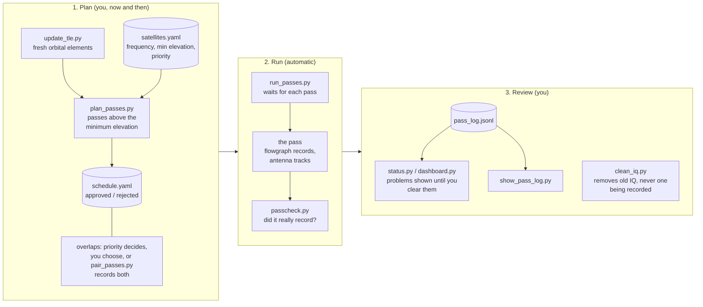
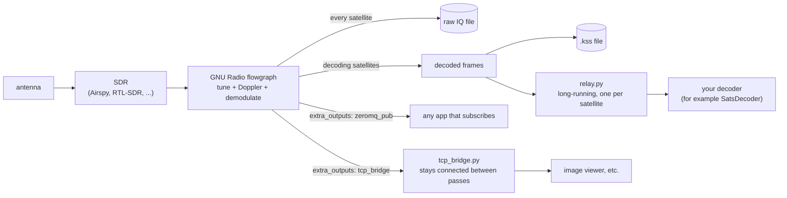
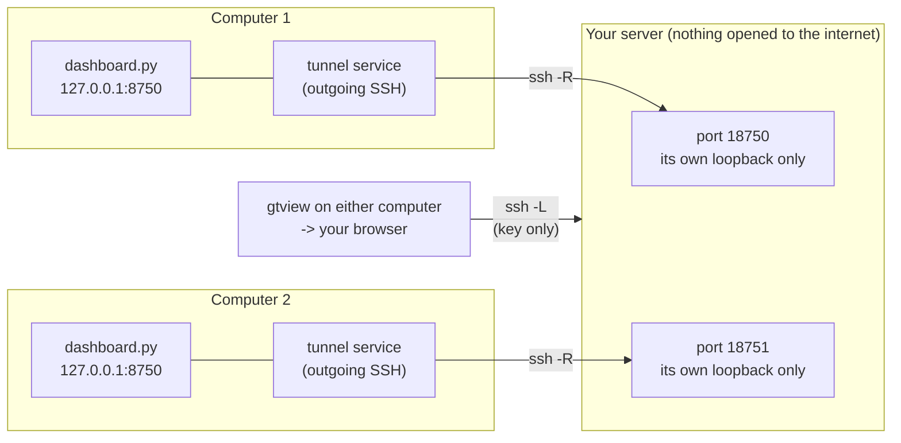

# Diagrams: how everything fits together

[← back to README](../README.md)

Three pictures, drawn with Mermaid, which GitHub shows as pictures when you open this page.

## 1. A day in the life of the schedule

From orbital data to a checked recording. The first box is what you do now and then, the second runs by itself, the third is what you look at.

More: [Daily workflow](daily-workflow.md), [Scripts reference](scripts-reference.md).

## 2. Where the signal goes, by kind of satellite

The flowgraph is universal. What comes after it is a choice per satellite.

`relay.py` and `tcp_bridge.py` exist because a flowgraph lives for one pass, while a decoder window is meant to stay open.
More: [Architecture](architecture.md), [Adding a satellite](adding-satellites.md).

## 3. Looking at the other computer's dashboard

Each computer serves a read-only status page on itself (port 8750). A tunnel it opens outward to your server makes it reachable from the other computer.
Nothing is opened to the internet.

More: [Remote dashboard](remote-dashboard.md).
